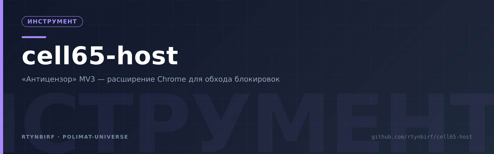
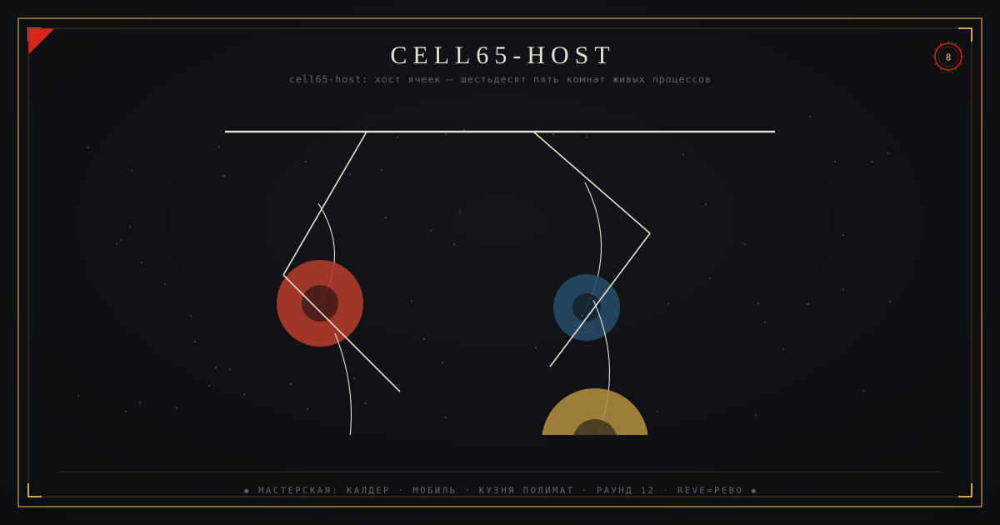
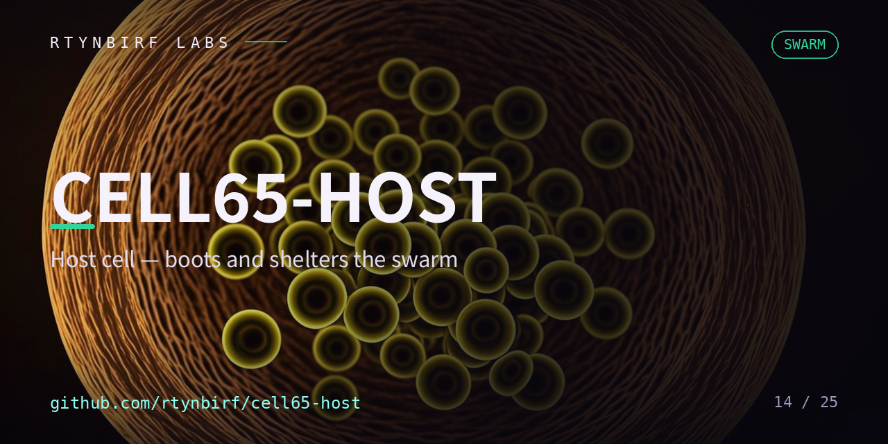

<div align="center">
  
</div>

<!--ФОРЖ:МУЗА:НАЧАЛО-->
<div align="center">
  
  <br/>
  
</div>
<!--ФОРЖ:МУЗА:КОНЕЦ-->


# cell65-host

<p align="center"></p>


Личный инфраструктурный хост. В репозитории — три независимые линии:

1. **[sovereign-node/](sovereign-node/)** — СУВЕРЕННЫЙ УЗЕЛ: личный anti-censorship
   комплект «настроил и забыл». Один бинарь sing-box на Windows 11, один VPS,
   лестница из трёх независимых транспортов (VLESS+Reality / VLESS+WS за Cloudflare
   CDN / Hysteria2) с авторотацией, развязка RU/не-RU. Архитектура, модель угроз
   и быстрый старт — в [sovereign-node/README.md](sovereign-node/README.md).
2. **[anticensormv3/](anticensormv3/)** — расширение Chrome **Manifest V3** «Антицензор»
   (v1.1.0): PAC-роутинг через локальный прокси, hosts-блокировка рекламы/трекеров
   (declarativeNetRequest), чистая новая вкладка, WebRTC-защита. Полная документация —
   ниже и в [docs/SOURCES.md](docs/SOURCES.md).
3. **[sovereign-node/codespace/](sovereign-node/codespace/)** — CODESPACE-УЗЕЛ:
   бесплатная личная прокси-машина на GitHub Codespaces (2 ядра/8 ГБ,
   120 core-часов/мес = 60 ч, без карты и телефона): gost внутри +
   SSH-туннель gh CLI + супервизор `65-codespace.ps1` со сторожем.
   Быстрый старт — [sovereign-node/codespace/README.md](sovereign-node/codespace/README.md).

Близнец по Manifest V3 — [free-man](https://github.com/rtynbirf/free-man): там FREE MAN
(блокировка слежки ИИ-сервисов: 72 домена, DNR, пауза по сайту), здесь cell65-host
«Антицензор» (обход блокировок: PAC/DNR/WebRTC/прокси). Две половины одной автономии
браузера: один открывает доступ, другой закрывает слежку. Общий принцип обоих —
без аккаунта, сервера и телеметрии.

- Лицензия — [LICENSE](LICENSE) (MIT). Сообщения об уязвимостях — [SECURITY.md](SECURITY.md).

---

# «Антицензор» MV3 — документация

Готовый, настроенный Chrome-плагин **Manifest V3** + самодостаточный PAC-скрипт:

1. **`anticensormv3/`** — расширение: PAC-роутинг «Антицензор» через локальный прокси, hosts-блокировка рекламы/трекеров (declarativeNetRequest), чистая новая вкладка, WebRTC-защита.
2. **`pac/antizensor.pac`** — тот же PAC-движок одним файлом: для системных настроек прокси (Windows/macOS), Firefox или другого браузера без расширения.

Всё локальное: ни телеметрии, ни внешних запросов, ни аналитики. Настройки — только в `chrome.storage.local`.

---

## 1. Установка расширения (Load unpacked, 4 шага)

1. Скачать/клонировать репозиторий; папка расширения — `anticensormv3/`.
2. Открыть `chrome://extensions`.
3. Включить **Режим разработчика** (правый верхний угол).
4. **Загрузить распакованное расширение** → выбрать папку `anticensormv3/`.

После установки откроется панель настроек автоматически. Минимальный Chrome: **121** (обусловлено лимитом DNR-правил 30 000, см. §5).

## 1.1. Быстрый старт из попапа (v1.1.0)

Щёлкните иконку расширения — два пути, оба приводят к открытию заблокированных сайтов:

**Путь А — одним кликом:** кнопка **«▶ Работает сразу: публичный „АнтиЗапрет"»** → расширение переключается на внешний PAC `https://antizapret.prostovpn.org/proxy.pac` (поле `pacScript.url` официального API — Chrome сам скачивает файл; второй официальный URL сервиса `https://p.thenewone.lol:8443/proxy.pac` вставляется кнопкой «Вставить „АнтиЗапрет"» в настройках). АнтиЗапрет проксирует только заблокированные сайты из реестра РФ — остальное напрямую, скорость не падает.

⚠️ **Верифицировано 31.10.2026:** сервис «АнтиЗапрет» отвечает `403 "Your geoip is not RU… THE SERVICE WORKS ONLY IN RUSSIA!"` любому клиенту вне RU-гео. Кнопка «Проверить» в попапе покажет это явно. Не в RU или сервис недоступен → путь Б.

**Путь Б — свой узел:** в попапе раскрыть **«НАСТРОЙКИ узла ▾»** → выбрать схему (SOCKS5/HTTP/HTTPS) → **вписать IP узла** и порт → выбрать «весь трафик» или «по списку PAC» → **«Сохранить и применить»**. Работает из любой страны, узел ваш — доверять третьим лицам не нужно.

Статус в попапе: `PAC · AZ` (внешний PAC) / `PAC · ON` (свой список) / `GLOBAL` / `OFF`; строка «PAC-источник» показывает, что именно активировано.

## 2. Режимы прокси (переключаются в попапе в один клик)

| Режим | Механика (официальный API `chrome.proxy`) | Поведение |
|---|---|---|
| **PAC · список** | `pac_script`, PAC генерируется из вашего списка | Через прокси идут только домены списка «Антицензор» (+ их поддомены); всё остальное — напрямую |
| **PAC · всё** | `pac_script`, `pacScope=all` | Через прокси всё, кроме исключений |
| **Всё через прокси** | `fixed_servers` (`singleProxy` + `fallbackProxy` + `bypassList`) | Весь HTTP/HTTPS через прокси |
| **Напрямую** | `direct` | Прокси выключен; блокировка рекламы продолжает работать |

Дефолт настроен: **SOCKS5 `127.0.0.1:1080`**, PAC-режим по списку, в списке — примеры формата (`twitter.com`, `x.com`, `facebook.com`, `instagram.com` — ограничены в ряде юрисдикций; заполните список под свою реальность).

### Изменённые параметры прокси

Панель настроек → §2: схема (`socks5`/`http`/`https`), хост, порт, логин/пароль (автоответчик `webRequest.onAuthRequired`, режим `asyncBlocking`).

Типичные порты локальных стеков: **Xray/v2rayN — 10808, sing-box — 2080, shadowsocks — 1080**. Точное значение смотрите в своём конфиге — расширению всё равно, какой стек слушает порт.

## 3. hosts-блокировка (реклама/трекеры)

Статические наборы DNR (`rules/ads.json` — 30 рекламных сетей, `rules/trackers.json` — 28 трекеров; классические домены из публичных блок-листов). Переключаются галочками.

**Импорт любых hosts-файлов:** Настройки → §5 → файл или вставка текста. Парсер понимает `0.0.0.0 domain`, `127.0.0.1 domain`, `||domain^`, `*.domain`, чистые домены, комментарии `# ! //`. Импорт заменяет предыдущий целиком; исключения (§4) не блокируются даже если есть в импорте.

CLI-конвертер для генерации статических наборов: `tools/hosts_to_dnr.py`.

## 4. Standalone PAC (без расширения)

```bash
python3 pac/build_pac.py --proxy "socks5 127.0.0.1:1080" --scope list
```

→ `pac/antizensor.pac`. Подключение:
- **Chrome/Edge**: системный прокси → «Использовать сценарий настройки» → путь/URL файла;
- **Firefox**: Настройки сети → URL автоматической настройки сервиса прокси;
- **Windows**: Параметры → Сеть → Прокси → «Использовать сценарий настройки».

Логика идентична движку расширения (без `dnsResolve`, ES5-тело, bypass приватных сетей).

## 5. Лимиты declarativeNetRequest (верифицировано, Chrome 121+)

| Параметр | Значение |
|---|---|
| Динамические правила | **30 000** (до Chrome 121 — 5 000) |
| Сессионные правила | 5 000 |
| Статических наборов | до 100 (включено одновременно — до 50) |
| Гарантированный минимум статических правил | 30 000 суммарно |
| `block`/`allow`/`allowAllRequests` | работают БЕЗ host-доступа (разрешение `declarativeNetRequest`) |
| `redirect`/`modifyHeaders` | требуют `declarativeNetRequestWithHostAccess` — в проекте не используются |

Расширение проверяет лимит при импорте: максимум 28 чанков × 1000 доменов, при превышении — явное предупреждение «ОБРЕЗАНО», не тихое падение.

## 6. Почему так: лучшие практики (все — из официальных доков, полный журнал в `docs/SOURCES.md`)

1. **Никакого `dnsResolve()`/`isInNet()` в PAC** — синхронно блокируют сетевой поток Chrome, ломаются на IPv6. Только строковый матчинг по хосту.
2. **`pacScript.mandatory = false`** — при сбое PAC сеть откатывается на DIRECT, а не умирает целиком; цепочка возврата `SOCKS5 host:port; DIRECT`.
3. **`singleProxy` для fixed_servers** — покрывает HTTP+HTTPS одним объектом (пример в доках с одним `proxyForHttp` оставляет HTTPS напрямую — ловушка, здесь она обойдена).
4. **DNS-утечка при SOCKS5**: Chrome при SOCKS-прокси резолвит имена **напрямую** (браузер не поддерживает `socks5h`). Антидот в проекте: подсказка + кнопка на `chrome://settings/security` (Безопасный DNS/DoH), либо используйте HTTP/HTTPS-прокси, где имя хоста уходит внутрь CONNECT-туннеля.
5. **WebRTC**: опциональная политика `default_public_interface_only` (`chrome.privacy.webrtc`) — локальные IP не утекают в ICE.
6. **QUIC/UDP**: при активном прокси Chrome не гоняет QUIC мимо прокси — транспорт откатывается к TCP, дыры в роутинге нет.
7. **MV3 — единственный вариант**: MV2 отключался поэтапно (июнь 2024 pre-stable → 2025 стабильные браузеры), финальное удаление обходных путей — июнь 2026.
8. **`browser.*`-неймспейс** стандартизирован с Chrome 148; проект использует классический `chrome.*` — работает и там, и там.
9. **`asyncBlocking` + `webRequestAuthProvider`** для авторизации прокси — MV3-шный способ, `webRequestBlocking` мёртв.

## 7. Новая вкладка

Часы + дата (RU), поиск (DDG/Google/Яндекс/Bing, выбор запоминается), редактируемые плитки ссылок, хоткей `/`. Ноль сетевых запросов, кроме вашего явного поиска/перехода. Фавиконки не подгружаются — плитки цветные заглушки (приватность).

**Политическая заметка:** в Chrome Web Store замена новой вкладки должна быть единственной целью расширения и явно декларироваться. Для распакованной установки это не применяется; при публикации в Store выносите newtab в отдельное расширение.

## 8. Тесты

```bash
cd tools && node test_pac.mjs
```

23 проверки PAC-движка: список/поддомены/wildcards/исключения/приватные сети/IPv6/all-mode/fixed_servers/нормализация. Файлы: `lib/pac-engine.js` (движок расширения) и `pac/antizensor.pac` (standalone) проверены `node --check`.

## 9. Структура

```
cell65-host/
├── anticensormv3/            # расширение (Load unpacked)
│   ├── manifest.json         # MV3, минимум Chrome 121
│   ├── background.js         # service worker (module): proxy/DNR/auth/badge
│   ├── lib/defaults.js       # дефолты
│   ├── lib/pac-engine.js     # генератор PAC + конфигов chrome.proxy
│   ├── lib/dnr-manager.js    # стат. наборы + импорт hosts → dynamic rules
│   ├── rules/{ads,trackers}.json
│   ├── options/ popup/ newtab/ icons/ _locales/{ru,en}/
├── sovereign-node/           # серверная линия: sing-box VPS + codespace-узел
│   └── codespace/            # бесплатный узел: gost + супервизор + батники
├── pac/build_pac.py          # сборщик standalone PAC
├── pac/antizensor.pac        # готовый PAC (дефолт: socks5 127.0.0.1:1080, list)
├── packs/antizensor-list.txt # список для PAC (заполняйте под себя)
├── packs/exceptions.txt      # исключения (DIRECT)
├── packs/hosts-starter.txt   # пример hosts-файла для импорта
├── tools/hosts_to_dnr.py     # hosts → DNR rules JSON (CLI)
├── docs/SOURCES.md           # журнал верификации фактов (URL + даты)
└── LICENSE (MIT)
```

## 10. Синхронизация со стоящей задачей «храним в репе»

Рабочая копия — `git`-репозиторий с историей коммитов. Push выполняется рабочим токеном (файл `/tmp/.ghtoken`, креды не попадают в URL). Бэкапы: `git bundle` + zip снимка дерева + zip папки расширения — в `download/`.

<!--ФОРЖ:ПОДВАЛ-->
---

<div align="center">
  <sub>◆ картина и штандарт — ручная ковка <a href="https://github.com/rtynbirf">КУЗНИ ПОЛИМАТ</a> · ЧЕЛОВЕК=АККАУНТ=PID1 ◆</sub>
</div>
